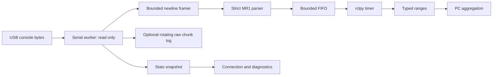

# Architecture and message semantics

Before each initial open or reconnect, the worker sets DTR=True and RTS=False on a closed pyserial handle. Bitcraze `src/f0/usbd_conf.c` derives `serialConnected` from USB CDC DTR, and `src/usbcomm.c` gates telemetry with `USBD_IsSerialConnected()`. DTR=False can therefore leave an open but stale connection receiving only startup output. RTS is unused; hardware/software flow control remains disabled. The same open function applies this handshake for every connection generation, independently of reference/follower identity, without transmitting serial commands.

The worker owns the serial handle and raw logger, requests 100 ms reads of at most 4096 bytes, and never calls serial write. A finite line buffer discards an oversized line through its next newline and resumes. Incomplete lines persist across read timeouts, but are cleared on disconnect so different capture generations cannot form one record. Parser errors and unrelated lines increment separate counters. Optional raw logging preserves all incoming bytes including corruption, startup output, partial lines and diagnostic records. Unknown MR1 fields/versions are rejected with a malformed counter rather than silently assigned new semantics.

Successful and failed AA/FF records enter a FIFO. On full FIFO the newest record is dropped and the counter increases; the parsed sequence still increases so downstream gaps are detectable. Overflow is the only intentional valid-record loss in application code. QoS history is independently bounded. No roles or expected reporting rates are assumed. Retry uses exponential, interruptible delay; successful bytes reset backoff. Every successful connection increments a generation. Shutdown wakes retry waits, joins the reader, closes serial/logs and drains up to one configured batch. Pending messages at termination and unmatched DDS discovery delivery are not guaranteed. This is a live telemetry bridge, not a lossless persistent broker.

`RangeMeasurement` fields:

- `received_at`: host Unix wall time when the read containing the newline completed. Several lines in one read can share it. USB buffering means it is not acquisition time. System clock adjustments can move it backwards. It is independent of ROS `/clock`.
- `host_alr_id`: configured robot ID; `reporter`: firmware `l`. Initiator/responder are `i/j`. Miswired USB identity is preserved and warned about, never overwritten or filtered.
- `capture_session`: UUID for this bridge process; `connection_generation`: increments on open; `sequence`: every parsed valid record, including queue-overflow records. Duplicate firmware records have distinct sequences.
- `cycle`: reference cycle `c`; `epoch`: 64-bit local firmware epoch `e`; `plan_fingerprint`: full-plan `p`. Stored as integers without interpretation or continuity assumptions. Boot restarts may repeat epochs; a bridge reconnect/session is not proof of firmware reboot. PC/operators must retain boot segments.
- `timestamp_dtu`: native 40-bit local DW1000 marker `t`, transported in uint64; `clock_domain=dw1000_local_40bit`; `marker=poll_tx`, `poll_rx` or `failure`. Marker domain belongs to reporter, not host or the reference clock. No unwrapping, conversion, uncertainty estimate or synchronization is inferred.
- `kind`: AA=1 or FF=4, directly from `b`. No host role parameter is needed. A follower can be initiator or responder in FF; it can report AA as responder.
- `status`: `s` (0 success, 1 failure); `valid`: status==0. `reason` preserves `why` including `ok`.
- `has_range`: explicit numeric presence. `distance_mm` is firmware selected/corrected `mm`, `raw_distance_mm` is `raw`. When absent the numeric ROS fields serialize as zero but are not a measured zero. Actual zero-valued successful ranges remain valid. `has_power_indicator` and `power_corrected` represent optional `q`. `valid` is firmware validity, not a claim of metrological accuracy.
- `raw_record`: complete ASCII MR1 text with no newline delimiter. Original chunk log preserves exact delimiters/bytes if enabled.

`ConnectionStatus` gives host wall stamp/session, generation/device/baud, connection/stale flags, last connection error, traffic/error/overflow/disconnect/reporter counters and monotonic ages. Age -1 means none in this connection. Connected means open descriptor, not confirmed RF activity. Measurement count is parsed count, not DDS acknowledgement. Failures count as parsed measurements. Disconnect counter also increments when the open connection closes during orderly shutdown.

Per-host `diagnostic_msgs/DiagnosticArray` reports ERROR disconnected, WARN stale or cumulative malformed/oversized/overflow/reporter mismatch, OK otherwise. Error counters are cumulative for the process. Logging is limited to health transitions; per-line parse failures are counters, avoiding console floods. Raw-log write/rotation errors disable only that optional sink, increment `raw_log_errors` and preserve `raw_log_error`; serial parsing and ROS publication continue. Original firmware LOG/SL1/AA1 text remains in optional raw logs, without invented typed measurement meanings.

The launch uses a per-ALR YAML and namespace `/uwb/alr_ID`; no identity or geometry is inferred from reference position. All four hosts can run the exact same installed package and default parser. Future PC work must partition sessions/epochs/plans and retain asynchronous endpoint reports before geometry/localization.
